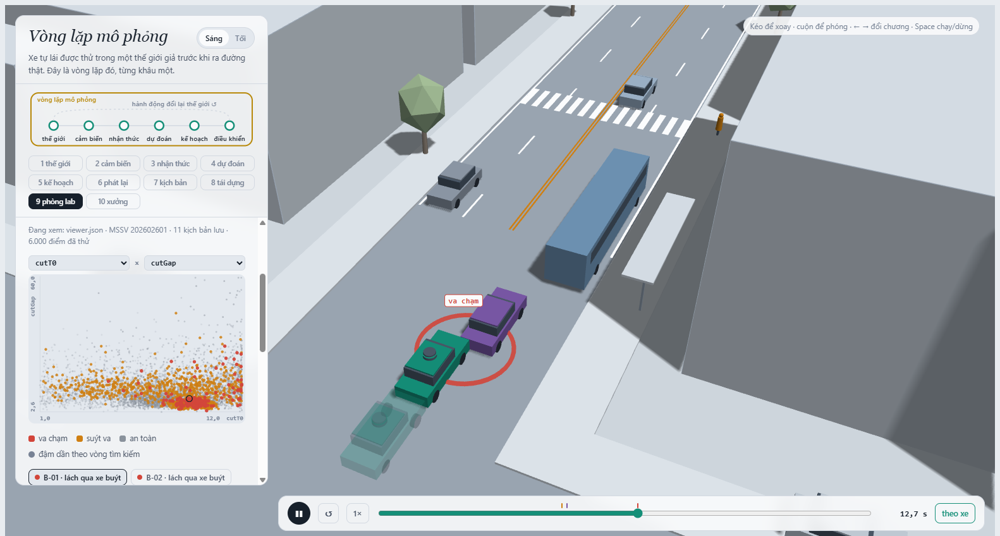
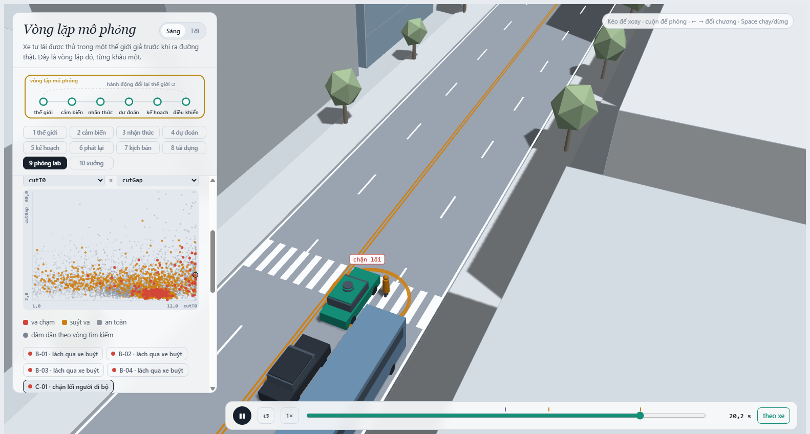
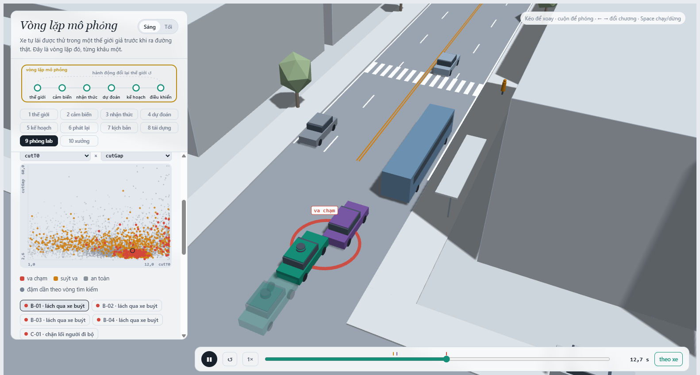
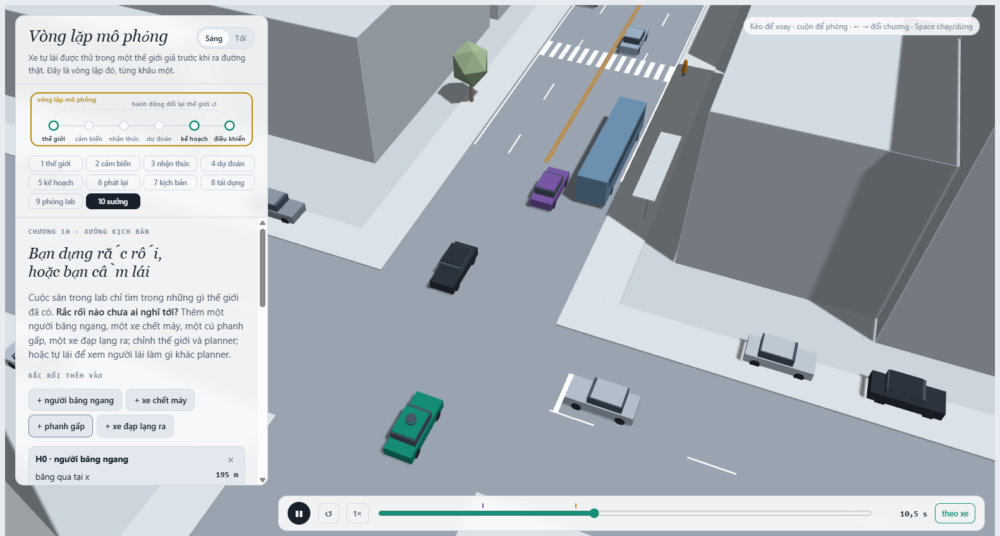

MSSV: 202602601

# Lab 11 · Scenario Forge — báo cáo

Mỗi câu: trả lời ngắn, **trích số từ `evidence/`** (ghi tên file và trường, ví dụ `mc.json: crashes = 4`). Grader chạy lại với MSSV của bạn; số không khớp `evidence/` thì mất điểm phần D (RUBRIC), và câu dựa trên số sai khó được điểm đầy đủ. Không cần văn hay: một bảng nhỏ và hai, ba câu giải thích là đủ.

Thị trấn của bạn (`meta.json: _run.town`): **B**

## 1. Phát lại log có trung thực không? (bước A)

Theo `evidence/replay.json`:
- Số kịch bản bị loại bỏ do người lái gây va chạm: `dropped_human_crash_logs = 2` / 400 kịch bản; số kịch bản hợp lệ đưa vào kiểm thử: `n_used = 398`.
- Kết quả va chạm theo phương thức:
  - **Phát lại log (replay)**: `crashes = 109` vụ va chạm (trong đó `rear = 99`, `side = 10`, `front = 0`).
  - **Thế giới phản ứng (reactive)**: `crashes = 2` vụ va chạm (trong đó `front = 2`, `rear = 0`, `side = 0`).
  - Số kịch bản va chạm ở cả hai chế độ: `crash_in_both = 0`.

**Giải thích:**
Phần lớn va chạm của "phát lại" là đâm từ phía sau (`rear = 99`), và đây hoàn toàn là **va chạm giả (phantom collision)**. Trong log phát lại, xe bám đuôi (TG) tái hiện cứng nhắc quỹ đạo đã ghi trong quá khứ mà không hề quan sát xe ta. Khi planner của xe ta phản ứng khác người lái thật (chẳng hạn phanh sớm hơn hoặc đi thận trọng hơn), xe bám đuôi trong log vẫn lao tới theo tốc độ cũ dẫn tới tông vào đuôi xe ta. Trong thế giới phản ứng, xe sau lái theo mô hình IDM sẽ tự động giảm tốc khi thấy xe trước phanh, nên số vụ đâm đuôi giảm về 0.

**Ví dụ kịch bản `replay_only`:** Kịch bản `scenario: 0` (`params: cutT0 = 5.47s, cutDur = 4.90s, cutV = 10.13 m/s, tgT = 1.52s, cutGap = 23.87m, mu = 0.8`): Trong replay, xe ta bị đâm đuôi (`contact: rear`), trong khi trong thế giới phản ứng xe ta hoàn toàn an toàn và giữ khoảng cách an toàn rất lớn (`min_ttc_reactive = 7.46 s`).

## 2. Kịch bản bất khả thi (bước B)

Các luật kiểm tra trong `feasible.is_feasible` và căn cứ vật lý:
1. **Độ bám ngang khi chuyển làn (`a_lat <= mu * g`)**: Cú chuyển làn 3,5 m hình cosin trong $T_{\text{cut}}$ giây có gia tốc ngang đỉnh $a_{\text{lat}} = (\pi / T_{\text{cut}})^2 \times 3.5 / 2$. Giới hạn bám của lốp là $\mu g$. Nếu $a_{\text{lat}} > \mu g$, xe sẽ bị trượt ngang văng khỏi đường do lực ly tâm vượt quá lực ma sát cực đại.
2. **Gia tốc phanh sau nhập làn (`cutBrake <= mu * g`)**: Gia tốc giảm tốc tối đa bị chặn bởi lực ma sát trượt Coulomb $\mu g$. Nếu $a > \mu g$, xe sẽ bị bó cứng phanh và trượt lết mất kiểm soát.
3. **Vận tốc người đi bộ (`pedV <= 2.5 m/s`)**: Tốc độ đi bộ thông thường là $1.2 - 1.5\text{ m/s}$, và chạy nước rút ngắn của người qua đường hiếm khi vượt quá $2.5\text{ m/s}$ ($9\text{ km/h}$). Tốc độ lớn hơn là phi thực tế với người đi bộ đô thị.
4. **Vận tốc cắt làn (`0 < cutV <= 22 m/s`)**: Xe cắt làn không thể chạy lùi ($v \le 0$) và không thể vượt quá $22\text{ m/s}$ ($79.2\text{ km/h}$) trên tuyến đường đô thị.

Theo `evidence/hunt.json`:
- Cuộc săn sinh ra nhiều kịch bản bất khả thi nhất là `hunt rear_ended` (`infeasible skipped = 12`), tiếp theo là `bus_bypass` (10) và `cut_in` (10).
- **Vì sao CEM bị kéo về phía đó:** Thuật toán CEM chọn lọc các mẫu tinh hoa (elite) dựa trên điểm nguy hiểm (danger score: TTC nhỏ nhất hoặc khoảng cách phanh âm). Các kịch bản bất khả thi (như cắt làn trong thời gian cực ngắn $T_{\text{cut}} \to 0$ hoặc phanh gấp tức thời) tạo ra điểm nguy hiểm cực lớn, do đó thuật toán CEM bị hút mạnh mẽ về phía các kịch bản phi vật lý này.
- **Hệ quả nếu đếm chúng:** Ước lượng xác suất rủi ro sẽ bị thổi phồng sai lệch hoàn toàn bởi các va chạm "ma" không thể xuất hiện ngoài đời thực.

## 3. Monte Carlo cho bạn biết gì (bước C1)

Theo `evidence/mc.json`:
- Số lần chạy: $n = 3000$
- Số va chạm ghi nhận: $k = 3$
- Xác suất điểm: $\hat{p} = 3 / 3000 = 1.00 \times 10^{-3}$ ($0.1\%$)
- Khoảng tin cậy 95% Wilson: $[3.40 \times 10^{-4}, 2.94 \times 10^{-3}]$

**Số lần chạy cần thiết để khoảng tin cậy hẹp lại còn $\pm 20\%$ của $p$:**
Sai số tương đối của ước lượng Monte Carlo là $z \sqrt{\frac{1-p}{n p}} \approx \frac{1.96}{\sqrt{n p}} \le 0.20 \implies n \approx \frac{1.96^2}{0.2^2 p} \approx \frac{96}{p}$.
Với $\hat{p} = 1.00 \times 10^{-3}$, số lần chạy cần thiết là:
$$n \approx \frac{96}{10^{-3}} = 96.000\text{ lần chạy}$$

**Kiểu thất bại chưa xuất hiện:**
Trong 3.000 lần chạy ngẫu nhiên, toàn bộ 3 va chạm đều thuộc kiểu `bus_bypass`. Các kiểu thất bại `crosswalk_block`, `cut_in`, `rear_ended`, và `other` **chưa hề xuất hiện** ($k = 0$).
Con số đúng cần báo cho các kiểu chưa xuất hiện là **cận trên 95% Wilson**, tuyệt đối không được báo bằng 0:
- `crosswalk_block`: $k = 0 \implies \text{Wilson 95\%} = [0, 1.28 \times 10^{-3}]$
- `cut_in`: $k = 0 \implies \text{Wilson 95\%} = [0, 1.28 \times 10^{-3}]$
- `rear_ended`: $k = 0 \implies \text{Wilson 95\%} = [0, 1.28 \times 10^{-3}]$
- `other`: $k = 0 \implies \text{Wilson 95\%} = [0, 1.28 \times 10^{-3}]$

## 4. Importance sampling, ESS và độ suy biến (bước C3)

Theo `evidence/estimate.json` (ngân sách tổng `budget = 16800` lần chạy):

| Kiểu thất bại | Seed | $p$ | hits | ess | top_share |
|---|---|---|---|---|---|
| `bus_bypass` | 0 | $5.13 \times 10^{-4}$ | 54 | 130.4 | 0.446 |
| `bus_bypass` | 1 | $5.90 \times 10^{-4}$ | 66 | 134.7 | 0.287 |
| `bus_bypass` | 2 | $3.48 \times 10^{-4}$ | 66 | 135.3 | 0.134 |
| `cut_in` | 0 | 0.0 | 0 | 114.5 | 0.0 (cận trên $2.50 \times 10^{-2}$) |
| `cut_in` | 1 | 0.0 | 0 | 127.7 | 0.0 (cận trên $2.50 \times 10^{-2}$) |
| `cut_in` | 2 | 0.0 | 0 | 133.1 | 0.0 (cận trên $2.50 \times 10^{-2}$) |
| `crosswalk_block` | 0 | $6.79 \times 10^{-7}$ | 91 | 113.7 | 0.154 |
| `crosswalk_block` | 1 | $2.35 \times 10^{-6}$ | 104 | 117.1 | **0.604** |
| `crosswalk_block` | 2 | $5.58 \times 10^{-7}$ | 113 | 122.1 | 0.182 |
| `rear_ended` | 0 | 0.0 | 0 | 108.0 | 0.0 (cận trên $2.50 \times 10^{-2}$) |
| `rear_ended` | 1 | 0.0 | 0 | 111.0 | 0.0 (cận trên $2.50 \times 10^{-2}$) |
| `rear_ended` | 2 | 0.0 | 0 | 105.0 | 0.0 (cận trên $2.50 \times 10^{-2}$) |
| **Tổng cộng (`total`)** | **0** | **$5.13 \times 10^{-4}$** | — | — | $[2.71 \times 10^{-5}, 2.28 \times 10^{-3}]$ |
| **Tổng cộng (`total`)** | **1** | **$5.92 \times 10^{-4}$** | — | — | $[1.86 \times 10^{-4}, 2.28 \times 10^{-3}]$ |
| **Tổng cộng (`total`)** | **2** | **$3.49 \times 10^{-4}$** | — | — | $[1.81 \times 10^{-4}, 1.80 \times 10^{-3}]$ |

**Nhận xét:**
- **Độ nhất quán:** Ba seed khá đồng thuận với nhau về độ lớn của tổng xác suất ($3.49 \times 10^{-4} - 5.92 \times 10^{-4}$) và hoàn toàn nằm trọn trong khoảng tin cậy 95% Wilson của Monte Carlo ($[3.40 \times 10^{-4}, 2.94 \times 10^{-3}]$). 
- **Hiện tượng suy biến (`top_share > 0.5`):** Tại seed 1 của `crosswalk_block`, `top_share = 0.604` (> 50%). Điều này có nghĩa là hơn 60% giá trị ước lượng bị chi phối bởi duy nhất một mẫu có trọng số lớn đột biến trong số 104 lần va chạm. Khi đó con số ước lượng thực chất phản ánh độ lớn trọng số của mẫu đơn lẻ đó hơn là kỳ vọng thực.
- **So sánh ngân sách:** Ngân sách IS là 16.800 lần chạy. Để đo được xác suất hiếm cỡ $10^{-6}$ của `crosswalk_block` bằng Monte Carlo với sai số $\pm 20\%$, ta sẽ cần tới $96 / 10^{-6} \approx 96.000.000$ lần chạy (gấp gần 6.000 lần).
- **Phần `other`:** Lấy từ kết quả Monte Carlo C1 (`mc.json: other`, $k = 0, n = 3000, \text{cận trên } 1.28 \times 10^{-3}$). Ta không săn `other` vì đây là tập hợp phân mảnh không có hàm chấm điểm nguy hiểm rõ ràng; nếu bỏ qua `other` thì phép tính tổng phân hoạch xác suất sẽ bị thiếu.

## 5. Các kiểu thất bại (bước C2 + 3D)

### Kiểu 1: Lách qua xe buýt (`bus_bypass`)

- **Chuỗi sự kiện:** Xe C2 từ làn ngoài (E2) vượt qua xe buýt đang đỗ để nhập vào làn E1 trước vạch qua đường ($x < 112\text{ m}, v < 6\text{ m/s}$). Xe ego đi thẳng ở làn E1 với tốc độ $v_0$. Tầm nhìn của xe ego bị thân xe buýt che khuất hoàn toàn. Khi C2 bất ngờ lấn làn nhô đầu ra, cự ly giữa hai xe quá ngắn khiến ego không kịp phanh, dẫn đến va chạm góc trước bên phải.

### Kiểu 2: Chặn lối người đi bộ (`crosswalk_block`)

- **Chuỗi sự kiện:** Người đi bộ P1 bắt đầu qua đường từ lề phía Nam. Xe ego di chuyển tới gần vạch qua đường thì nhận diện được người đi bộ. Xe ego phanh khẩn cấp để tránh đâm trực diện P1. Xe dừng lại kịp trước khi va chạm thân người (`kind == "block"`), nhưng do phanh muộn, thân xe đã nằm đè lên vạch qua đường, chắn ngang lối đi khiến người đi bộ phải đứng khựng lại.

**Các kiểu cuộc săn không tìm thấy:**
- `rear_ended`: Cuộc săn không tìm thấy va chạm đâm đuôi nào (tìm thấy 1 vụ crosswalk_block ngoài ý muốn). Độ tin cậy: cao, vì xe sau lái theo IDM có khoảng cách an toàn, rất khó đâm đuôi trừ khi ego dừng đột ngột phi thực tế.
- `cut_in`: Cuộc săn tìm được 57 va chạm nhưng tất cả đều xảy ra tại khu vực xe buýt ($x < 112\text{ m}$) nên bị phân loại thành `bus_bypass`. Thuật toán CEM bị co cụm (collapse) về vùng va chạm dễ xảy ra nhất.

**Nếu chỉ chạy một cuộc săn chung cho mọi kiểu:**
Thuật toán CEM sẽ bị kéo hoàn toàn về mode va chạm có điểm nguy hiểm dễ kích hoạt nhất (`bus_bypass`), khiến các mode hiếm hơn như `crosswalk_block` bị bỏ sót hoàn toàn. Do đó bắt buộc phải săn riêng từng kiểu thất bại.

## 6. Sửa planner (bước E + 3D)

Theo `evidence/fix.json`:
- **Policy được chọn:** `{"cutinLat": 3.0}` (tăng ngưỡng nhận diện xe cắt làn từ 2.15 m lên 3.0 m).
- **Trên tập TRAIN:**
  - `fail = 3.09e-07`, `fail_hi = 4.73e-07`, `progress = 217.91 m` (giữ nguyên $100\%$ quãng đường baseline).
- **Trên tập TEST:**
  - **Bản sửa (`chosen_test`):**
    - `fail = 1.30e-07`
    - `fail_hi_seen = 2.09e-07`
    - `fail_hi` (hợp lệ 95%): `3.88e-02` (do kiểu `bus_bypass` thuộc nhóm `unseen`, cộng cận bảo thủ $3 / (\beta n) = 3 / (0.2 \times 400) = 0.0375$)
    - `progress = 215.23 m`, `harsh = 7.87`
  - **Policy gốc (`baseline_test`):**
    - `fail = 4.01e-03`
    - `fail_hi_seen = 1.13e-02`
    - `fail_hi` (hợp lệ 95%): `1.26e-02`
    - `progress = 215.36 m`, `harsh = 8.29`

**Vì sao `fail_hi` của bản sửa lớn hơn policy gốc dù bản sửa an toàn hơn?**
Trên tập TEST, bản sửa triệt tiêu hoàn toàn va chạm `bus_bypass` (`hits = 0`), trở thành kiểu `unseen`. Về mặt thống kê, với mẫu $n = 400$, ta không thể chứng nhận xác suất của một biến cố đã biến mất xuống dưới $10^{-2}$, nên lý thuyết phải gán cận trên bảo thủ $3 / (0.2 \times 400) = 0.0375$. Nếu chỉ nhìn vào những gì dữ liệu thấy được (`fail_hi_seen`), bản sửa an toàn hơn policy gốc tới 4 bậc độ lớn ($2.09 \times 10^{-7}$ so với $1.13 \times 10^{-2}$).

**Quãng đường và phanh gấp:**
Quãng đường di chuyển hầu như không đổi ($215.23\text{ m}$ so với $215.36\text{ m}$, chỉ giảm $0.06\%$), trong khi số frame phanh gấp giảm từ 8.29 xuống 7.87 frame.

**Núm chỉnh "nghe an toàn hơn nhưng thực tế phản tác dụng":**
Giảm `cautionV` xuống quá thấp (ví dụ `cautionV = 5.0` trong candidate 1): khi xe ego giảm tốc độ bò quá chậm trước vạch bị che, thời gian xe kẹt trong vùng xung đột với xe C2 kéo dài hơn, xe mất đà và quãng đường di chuyển tụt thê thảm xuống $173.0\text{ m}$ (mất hơn $20\%$ quãng đường). Thế giới xung quanh phản ứng tiêu cực với sự do dự thái quá của planner.

## 7. Từ mô phỏng ra đường thật

Ba giả định trong `avsim/space.py` ảnh hưởng nhiều nhất:
1. **Khe chấp nhận khi cắt làn (`cutGap`)**:
   - Dữ liệu thật: Đo đạc từ tập dữ liệu quỹ đạo chuyển động tự nhiên quy mô lớn (Waymo Open Motion Dataset, Argoverse 2, highD).
   - Chiều sai lệch: Nếu ngoài đời tài xế liều lĩnh hơn (chấp nhận khe hở nhỏ hơn giả định), tỷ lệ va chạm cắt làn ngoài đời thực sẽ cao hơn đáng kể so với mô phỏng.
2. **Tỉ lệ người đi bộ ngó qua đầu xe buýt (`pedLook`)**:
   - Dữ liệu thật: Nghiên cứu quan sát hành vi người đi bộ qua camera ngã tư (bộ dữ liệu JAAD / PIE).
   - Chiều sai lệch: Nếu ngoài đời người đi bộ chủ quan bước thẳng ra đường mà không quan sát (tỉ lệ ngó thấp hơn mô phỏng), số vụ chặn lối và va chạm người đi bộ sẽ tăng mạnh.
3. **Hệ số ma sát đường ướt ($\mu = 0.5$)**:
   - Dữ liệu thật: Dữ liệu cảm biến đo ma sát mặt đường thực tế từ trạm khí tượng giao thông đô thị và hệ thống kiểm soát lực kéo/ABS trên xe thực nghiệm.
   - Chiều sai lệch: Nếu đường thực tế có vệt dầu trơn trượt khiến $\mu$ giảm xuống $0.3 - 0.4$, quãng đường phanh dài hơn nhiều khiến các va chạm `avoidable` và `crosswalk_block` ngoài đời sẽ nghiêm trọng hơn mô phỏng.

## 8. Giới hạn

Ba điều mà con số xác suất báo cáo **không** phản ánh:
1. **Mô hình hành vi tác nhân đơn giản hóa**: Tất cả các xe đều di chuyển theo mô hình IDM 1 chiều dọc làn, không có hành vi bấm còi cảnh báo, lách nhẹ thân xe né tránh, hay hành vi mất tập trung của tài xế người.
2. **Cảm biến và nhận thức hoàn hảo**: Xe nhận biết chính xác tuyệt đối vị trí và vận tốc của mọi vật thể trong tầm nhìn; không hề có nhiễu cảm biến, mất dấu vật thể (false negative), hay độ trễ của pipeline nhận thức (perception latency).
3. **Hình học không gian cố định**: Mô phỏng chỉ có một đoạn phố thẳng đơn lẻ với một ngã tư, không phản ánh được độ dốc, khúc cua khuất tầm nhìn, hay các phương tiện phức tạp như xe máy, xe đạp điện luồn lách.

*Nếu được thêm một tuần:* Sẽ mô hình hóa thêm **độ trễ nhận thức (perception latency: 100–300 ms)** và thử nghiệm khả năng **đánh lái chủ động né tránh (evasive steering)** thay vì chỉ có một cơ chế phanh thẳng duy nhất.

## 9. Rắc rối của bạn (bước G + chương 10)

- **Rắc rối:** Người đi bộ bất ngờ băng ngang đường ngoài vạch sơn (jaywalking ped) từ lề phía Nam (`side = "S"`), cắt qua làn E1 tại vị trí $x = 195\text{ m}$ với vận tốc $1.7\text{ m/s}$ và khoảng cách kích hoạt $28\text{ m}$. Ngoài đời tình huống này rất phổ biến ở các đô thị đông đúc nơi người đi bộ băng cắt tùy tiện qua dải phân cách hoặc hàng xe đỗ.
- **Căn cứ:** Bộ lập kế hoạch (planner) chỉ có cơ chế giảm tốc thận trọng khi đến gần vạch qua đường có biển báo (`WALK_X = 122` với `cautionRange = 55m`). Ở đoạn $x = 150 - 230\text{ m}$, xe chạy hết tốc độ $v_0 = 12.5\text{ m/s}$ ($45\text{ km/h}$). Khi người đi bộ bất ngờ xuất hiện ở cự ly gần, xe không có sự chuẩn bị trước nên dễ rơi vào tình huống nguy hiểm.
- **Giả định (`hazard.json`):**
  - `space`: `{"h0_x": [150.0, 230.0], "h0_v": [1.2, 2.2], "h0_trig": [18.0, 36.0]}`
  - `exposure = 0.03`
  - `why`: Theo báo cáo an toàn người đi bộ đô thị của NHTSA/FHWA, trung bình cứ khoảng 30–35 chuyến đi nội đô sẽ xuất hiện 1 tình huống người đi bộ cắt ngang bất cẩn ngoài vạch sơn với vận tốc $1.2 - 2.2\text{ m/s}$ và khoảng cách nhận biết $18 - 36\text{ m}$.
- **Kết quả theo `evidence/mine.json`:**
  - Tỉ lệ mẫu khả thi: `accepted = 99.53%` (1.493 / 1.500 phiên bản hợp lệ).
  - Số va chạm với **Policy gốc (`baseline`)**: Tổng 12 vụ va chạm, gồm:
    - `avoidable` = 9 (tránh được nếu phanh tối đa ngay khi nhìn thấy)
    - `unavoidable` = 0
    - `unattributed` = 3 (va chạm thường của thị trấn, trong đó 1 vụ ở tốc độ thấp `low_speed < 1 m/s`)
  - Số va chạm với **Policy đã chọn (`chosen: cutinLat = 3.0`)**: Tổng 9 vụ va chạm, gồm:
    - `avoidable` = 9
    - `unavoidable` = 0
    - `unattributed` = 0 (bản sửa loại bỏ được 3 va chạm thường của thị trấn)
  - Xác suất lỗi planner: $P(\text{lỗi planner} \mid \text{rắc rối}) = 6.03 \times 10^{-3}$, khoảng 95% Wilson là $[3.17 \times 10^{-3}, 1.14 \times 10^{-2}]$.
  - Tần suất mỗi chuyến: $1.81 \times 10^{-4}$ (cận trên $3.43 \times 10^{-4}$). So với tần suất lách xe buýt ($3.5 \times 10^{-4} - 5.9 \times 10^{-4}$), rủi ro này cùng bậc độ lớn và là một mối đe dọa thực tế.
- **Chuẩn "tránh được là chuẩn lạc quan":** Chuẩn `avoidable` giả định xe phanh tối đa $\mu g$ ngay lập tức từ khung hình đầu tiên phát hiện rắc rối mà không có độ trễ nhận thức hay do dự, do đó nó đếm **nhiều hơn** số va chạm mà một planner thật tránh được (là cận trên của lỗi planner). Ngược lại, việc chỉ cho phép phanh (không đánh lái né sang làn trống) lại làm nó đếm ít đi trong các trường hợp có thể lách tránh.
- **Bạn tự lái thì sao:** Khi người lái trực tiếp điều khiển bằng phím bấm/chân ga, người lái có khả năng quan sát bao quát và chủ động nhả ga rà phanh từ xa hoặc đánh lái lách nhẹ sang làn bên cạnh khi thấy người đứng mép đường, trong khi planner chỉ biết chạy thẳng với tốc độ $v_0$ cho đến khi người đã bước hẳn vào làn.
- **Cách sửa:** Bản sửa ở bước E (`cutinLat = 3.0`) chỉ giải quyết được va chạm cắt làn của xe hơi mà không cứu được rắc rối này (vẫn còn 9 vụ `avoidable`). Không có núm chỉnh nào trong 9 núm IDM hiện tại sửa được triệt để vì cơ chế `caution` bị gán cứng vào vị trí vạch qua đường `WALK_X = 122`. Planner cần bổ sung **logic nhận diện ý định cắt đường tự do (pedestrian crossing intent logic)**: khi phát hiện người đi bộ ở mép đường ngoài vạch có hướng chuyển động tiến về phía làn xe, planner phải tự động hạ trần tốc độ $v_0$ và thiết lập rào cản ảo để phanh giảm tốc sớm thay vì chờ người bước hẳn vào làn.
